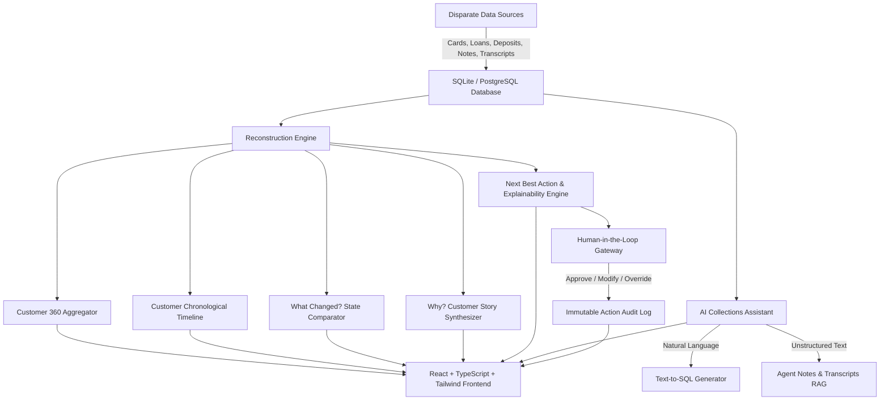

# Collection Copilot 360 – AI Customer Story & Next Best Action

> **Hackathon Core Differentiator:**  
> **Do NOT make this just a dashboard or chatbot.**  
> Built around a **Customer Story Reconstruction Engine** that combines customer financial data and interaction history into a chronological customer story to answer:  
> *“What is the complete customer story, what changed, and what is the next best action with an explanation and human approval?”*

---

## 🌟 Executive Summary & Problem Solved

In retail and SME collections, customer information is severely fragmented across siloed credit card cores, loan servicing systems, deposit ledgers, dialer logs, CRM touchpoints, agent case notes, and voice call transcripts. 

**Collection Copilot 360** breaks down these silos by:
1. **Unifying Data into a Collections 360 Profile:** Cards + Loans + Deposits + Cases + PTPs + Transcripts.
2. **Reconstructing the Chronological Customer Timeline:** Every payment, broken promise, SMS, call, and note.
3. **Powering the “What Changed?” Engine:** Pinpoints exactly what transitioned between previous baseline behavior and current delinquency (e.g. salary ERP delay, disputed charge, or cash flow freeze).
4. **Generating the “Why?” Customer Story:** Distinguishes **Direct Ground-Truth Facts** from **AI-Generated Interpretations**.
5. **Recommending the Next Best Action (NBA):** Provides single high-impact action, optimal channel, suggested timing, confidence %, and a visible **“Why this recommendation?”** explainability card.
6. **Enforcing Human-in-the-Loop Governance:** AI **never** triggers actions automatically. Agents can **Approve**, **Modify**, or **Override** with audit-logged justifications.
7. **Empowering Collectors with an AI Assistant:** Natural language questions with **Text-to-SQL** for analytics and **RAG** over agent notes and call transcripts, with strict domain guardrails.
8. **Auditing Data Quality & Compliance:** Real-time health scoring, duplicate ID detection, and algorithmic non-use of protected attributes (ECOA / FDCPA compliant).

---

## 🏛️ System Architecture



### Technology Stack
- **Backend:** Python 3.10+, FastAPI, SQLAlchemy, Pandas, SQLite / PostgreSQL
- **Frontend:** React 18, TypeScript, Tailwind CSS, Lucide Icons, Vite
- **AI / Reasoning:** Pluggable Heuristic & Template Reasoning Engine with seamless LLM provider swap (OpenAI, Anthropic, Gemini)
- **Security & Governance:** Read-only analytical queries, guardrails against out-of-scope prompts, non-use of protected attributes

---

## 👥 Hackathon Showcase Personas

| Customer ID | Name | DPD | Root Cause Diagnosis | Next Best Action | Recommended Channel | Suggested Timing |
| :--- | :--- | :---: | :--- | :--- | :--- | :--- |
| **CUST-1001** | **John Doe** | 18 | **Salary ERP Delay:** Employer TechSys Corp migrated to Workday ERP, causing a 10-day payroll gap. Flawless 36-month payer. | Send Automated Payment Link via SMS & Schedule Soft Call Follow-Up | **SMS + Phone** | Friday Morning at 10:00 AM (Targeted Salary Release Window) |
| **CUST-1002** | **Priya Sharma** | 32 | **Disputed Card Charge:** Unresolved $1,420 fraudulent foreign charge (Ticket #FRD-88219). Holds $42.5k in bank savings. | Suppress Collections Outreach & Expedite Fraud Dispute Provisional Credit | **Internal Routing + Reassurance Email** | Immediate (Within 2 Hours) |
| **CUST-1003** | **Robert Chen** | 64 | **SME Cash Flow Crisis:** 3 consecutive broken PTPs. Phone call avoidance (hung up on collector), but reads 100% of WhatsApp notifications within 8 mins. | Dispatch WhatsApp Self-Service Loan Restructuring Proposal (Tenure Extension) | **WhatsApp** | Today 4:00 PM - 5:00 PM (Post-Driving Hours) |
| **CUST-1004** | **Sarah Connor** | 42 | **Freelance Hardship:** Tech layoff client contract cancellation. Actively looking for work; requests lowered EMI. | Offer 6-Month Loan Restructuring & Deferral Plan | **Mobile App Push** | Tomorrow 11:00 AM |
| **CUST-1005** | **Elena Rostova** | 22 | **VIP Travel Miss:** International consulting trip to Tokyo. 100% email engagement; holds $115k on deposit. | Priority Email with 1-Click Apple Pay / Google Pay Link | **Email** | Immediate |

---

## 🚀 Quickstart & Setup Instructions

### Prerequisites
- **Python 3.10+**
- **Node.js 18+ and npm**

### 1-Click Launch (Windows)
Double-click `run_app.bat` or run:
```powershell
.\run_app.bat
```
*(Or in PowerShell: `.\run_app.ps1`)*

### Manual Launch

#### Step 1: Start Backend (FastAPI)
```bash
cd backend
python -m pip install -r requirements.txt
python synthetic_data.py
python -m uvicorn main:app --host 127.0.0.1 --port 8000 --reload
```
- API Healthcheck: `http://127.0.0.1:8000/api/health`
- Swagger UI Interactive Docs: `http://127.0.0.1:8000/docs`

#### Step 2: Start Frontend (Vite + React)
```bash
cd frontend
npm install
npm run dev
```
- Web Application: **`http://127.0.0.1:5173`**

---

## 🧭 Live Demo Flow for Judges

Follow this structured flow to showcase the core differentiator:

1. **Dashboard (`http://127.0.0.1:5173/`):**
   - Review executive KPIs: Active cases, total overdue exposure, broken promises, high-priority accounts, pending human reviews.
   - Inspect the DPD Bucket Distribution chart and Channel Effectiveness Benchmark.
2. **Customer Search & Persona Chips:**
   - Click the top demo chip **`John Doe (Salary Delay)`** or use the top search bar.
3. **Customer Workspace:**
   - **Customer Header:** View credit score (745), $770 overdue, $4.6k deposit cushion, and 18 DPD.
   - **Next Best Action Tab:** View recommended action (*Send Automated Payment Link via SMS*), timing (*Friday 10:00 AM*), 94% confidence, and the visible **“Why this recommendation?”** explainability section.
   - **Human-in-the-Loop Action:** Click **Approve Action** → click **Confirm & Log Approval**. Observe the success toast and see the action immediately appended to the **Customer Action Audit Trail**.
   - **“Why?” Customer Story Tab:** Read the synthesized narrative. Observe the clear dual-column separation between **Direct Ground-Truth Facts** and **AI-Generated Interpretations**.
   - **“What Changed?” Engine Tab:** Review the Previous vs Current situation cards, AI State Transition Explanation, and delta severity table.
   - **Chronological Timeline Tab:** Filter by payments, calls, SMS, notes, and transcripts.
   - **Unified Customer 360 Tab:** View credit card balance, auto loan details, and deposit accounts.
4. **Persona Switcher:**
   - Click **`Robert Chen (3x Broken PTP)`**. Note how the AI switches strategy from phone calls to **WhatsApp Hardship Restructuring**, recognizing phone avoidance and 3 broken promises.
5. **AI Collections Assistant:**
   - Click **AI Assistant** in the top navigation.
   - Click preset: **`Show customers with broken promises.`** → Observe generated SQL, data source badges, and tabular results.
   - Click preset: **`Why did this customer miss the promise?`** → Observe RAG synthesis from agent notes and call transcripts.
   - Type an out-of-scope query like *"What is the weather?"* → Observe courteous refusal enforced by the collections domain firewall.
6. **Data Quality Diagnostics:**
   - Click **Data Quality** in the navigation. Review the 100% Health Grade, missing values checks, duplicate ID scans, stream freshness, and 98.6% entity matching confidence.
7. **Governance & Audit Trail:**
   - Click **Governance** in the navigation. Switch roles between Agent, Supervisor, and Compliance. Inspect the permanent immutable audit log containing your approved decision, and read the FDCPA/ECOA protected attribute exclusion certificate.

---

## 🗄️ Database Schema Details

The application consumes realistic collections datasets mapped to relational tables:

- `customers`: ID, full name, phone, email, employer, income, credit score, risk tier, KYC status.
- `card_accounts`: Account number masked, card type, limit, current balance, min due, due date, DPD, status.
- `loan_accounts`: Loan ref, loan type, principal, outstanding balance, EMI, tenure, DPD, status.
- `deposit_accounts`: Account type, masked number, balance, currency, last activity date, status.
- `collections_cases`: Case ref, status, stage, DPD bucket, total overdue, priority, assigned agent.
- `promise_to_pay`: Amount promised, promise date, status (Kept / Broken / Pending), agreed channel, broken reason.
- `payment_history`: Payment ref, account type, amount, payment date, method, status.
- `contact_history`: Channel, direction, outcome, duration, agent ID, notes summary, timestamp.
- `agent_notes`: Agent name, category, note text, customer sentiment, timestamp.
- `call_transcripts`: Audio call ref, duration, transcript text, summary, key commitments, customer sentiment.
- `external_scores`: Bureau score, risk grade, telco stability index, spending index, capacity to pay.
- `audit_action_logs`: Recommendation ID, agent name, action taken (Approved / Modified / Overridden), final action, final channel, collector rationale, timestamp.

---

## 🛡️ Governance & Model Explainability

1. **Role-Based Access Control (RBAC):** Distinct workflows for Collections Agent, Team Lead/Supervisor, and Compliance Auditor.
2. **Strict Human-in-the-Loop Mandate:** No communication or account action is ever triggered without human agent approval.
3. **Protected Attributes Non-Use Policy:** Compliant with ECOA and FDCPA. Demographic indicators (race, gender, age, religion, marital status) are strictly excluded from recommendation heuristics.
4. **Explainability by Design:** Every recommendation details:
   - Data Signals Utilized
   - Counter-Actions Evaluated & Suppressed
   - Expected Behavioral Outcome

---

## 📄 License
MIT License. Built for the Collections Hackathon.
